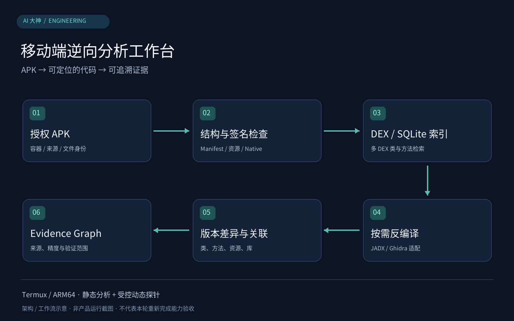

<div align="center">

# 逆向分析工坊｜Reverse Engineering Workbench

**将大体积 APK 索引、按需反编译与受控 Frida 挂载带入 Android/Termux ARM64 环境。**

</div>

本项目派生自 REA 上游并保留 MIT 许可。针对移动端大包分析痛点，在专用分支中拓展了 Android/Termux ARM64 运行适配，引入 SQLite 索引加速、签名与资源分析、版本差异对比及 Evidence Graph 证据链追踪。



> 图1：REA 6.5 (Android ARM64分支) 多DEX内存映射索引与Evidence Graph v2静态架构示意图（基于源码设计绘制，非实机运行截图）

## 它如何工作

针对 Termux/Bionic ARM64 环境的内存与进程约束，先为大型 APK 中的 DEX 建立 SQLite 结构索引，再检索目标类并交给 JADX 按需反编译。Native 库通过独立 Ghidra 适配路径分析。签名、资源、版本差异与证据记录由专项工具组织，保留来源、精度及已验证范围。动态附加探针独立受控运行，不能等同于生产动态 Broker 已全部接通。

## 核心技术与工程取舍

| 技术机制 | 为什么这样做 |
| --- | --- |
| 多DEX mmap映射与SQLite符号索引 | 减少一次性反编译整个 APK 的资源压力，结构索引可持久化并供后续查询使用；首次建库仍有读取和解析成本，未公布统一检索延迟指标。 |
| DEX 索引与 JADX 单类反编译 | 先定位目标类，再生成相关 Java 代码；Ghidra 处理 Native 路径，两类引擎各司其职，不把 SO 当 Java 类反编译。 |
| Evidence Graph v2图谱数据模型 | 为证据保留来源、精度、置信度和稳定指纹，便于区分观察事实与推断；并不代表所有动态数据已自动接入。 |
| 受控Frida Attach动态采集接口 | 对限定包名和 PID 的自有应用做 attach/script/detach 验证，任务结束清理临时进程；不附加系统进程，不宣称通用脱壳。 |

## 一个具体使用场景

分析两个授权 APK 版本时，先检索 DEX 类与方法，再检查版本差异，最后按需反编译相关类。需要运行态信息时另行使用受控动态探针，并单独记录验证范围。

## 从这里开始

```sh
git clone --branch android-termux-workbench https://github.com/AI-Dashen/rea.git
cd rea
extensions/android-termux-workbench/bin/rea-workbench index \
  --input /path/to/authorized.apk --job first-analysis
```

先按[手机增强版指南](https://github.com/AI-Dashen/rea/blob/android-termux-workbench/extensions/android-termux-workbench/README.md)准备依赖。此命令用于结构索引，不执行目标应用。

## 实现与验证范围

已验证Termux/Bionic ARM64下多DEX索引、按需反编译、版本对比及自有受控App的Frida attach实测；生产级动态Broker尚未接完，热进程重复attach稳定性有限，不含通用脱壳或模型解密能力。

## 分支、来源与许可证

手机增强代码在 [`android-termux-workbench`](https://github.com/AI-Dashen/rea/tree/android-termux-workbench)，通用上游代码保留在 `main`。本项目基于 [morluto/rea](https://github.com/morluto/rea) 派生；[MIT 许可](LICENSE)与[第三方说明](THIRD_PARTY_NOTICES.md)保留。Ghidra、JADX 与 Frida 等引擎各有自己的来源和许可。
